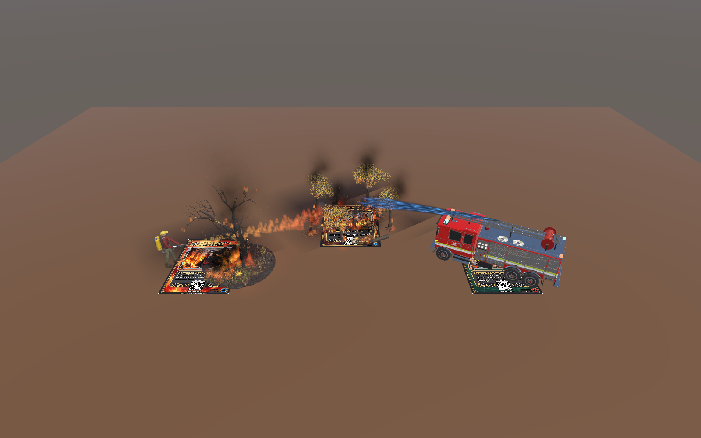
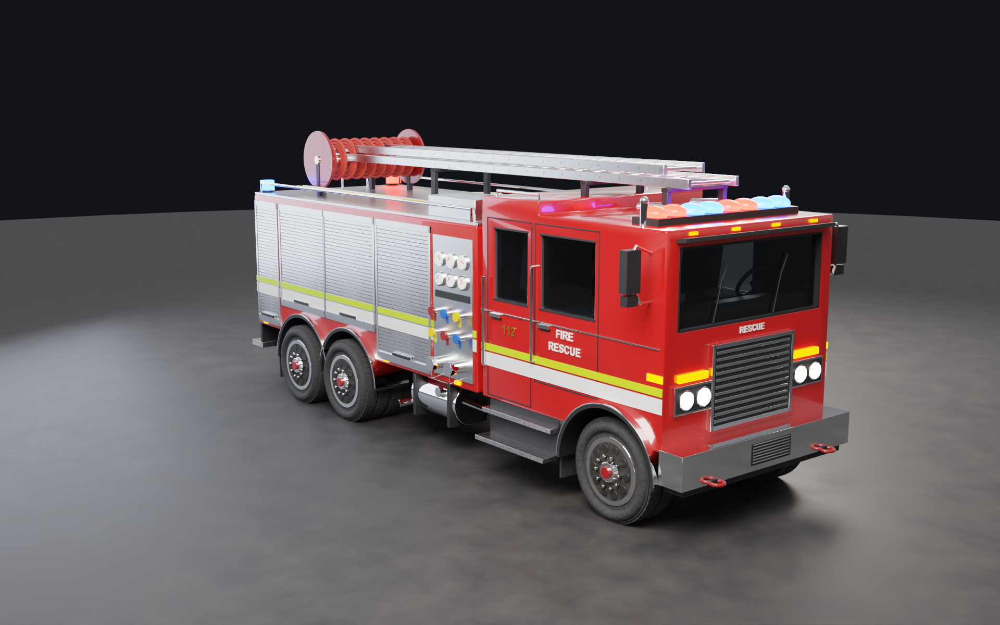
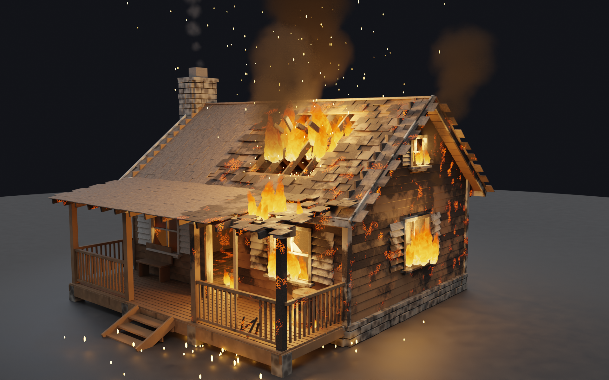
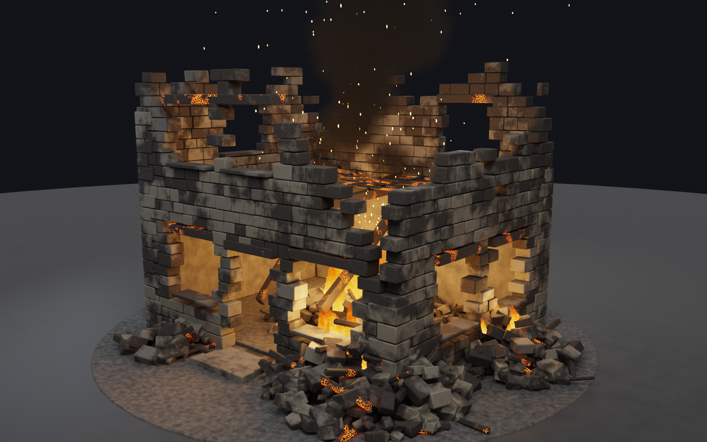
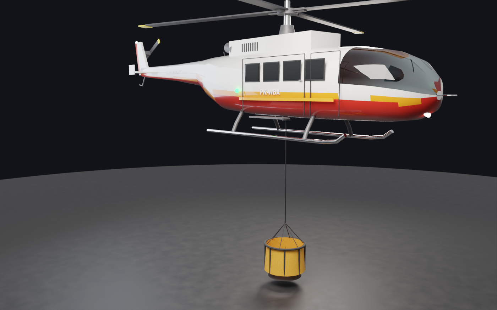
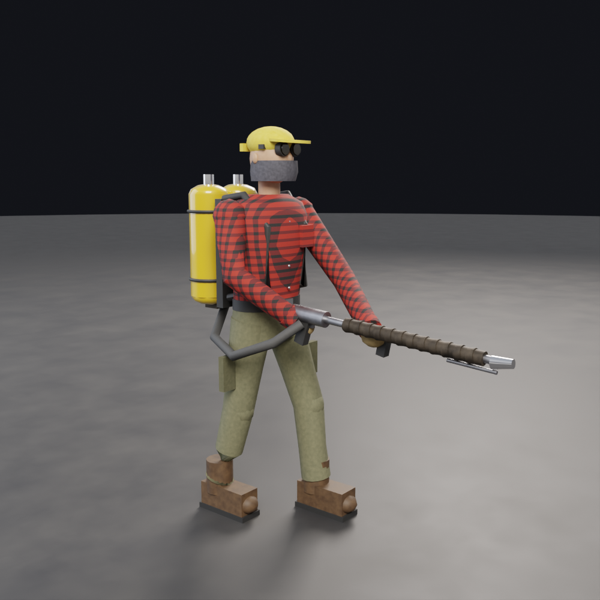
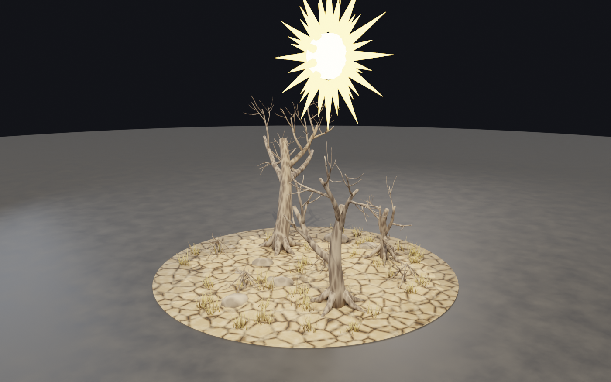
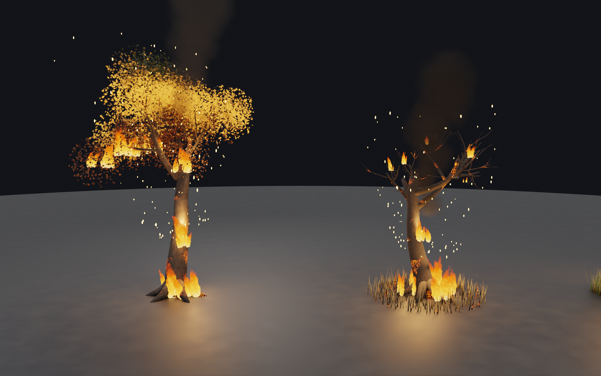
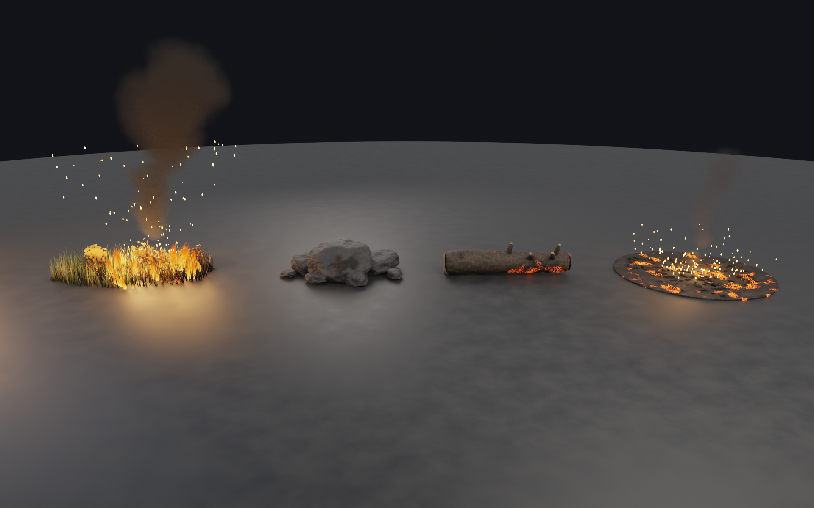
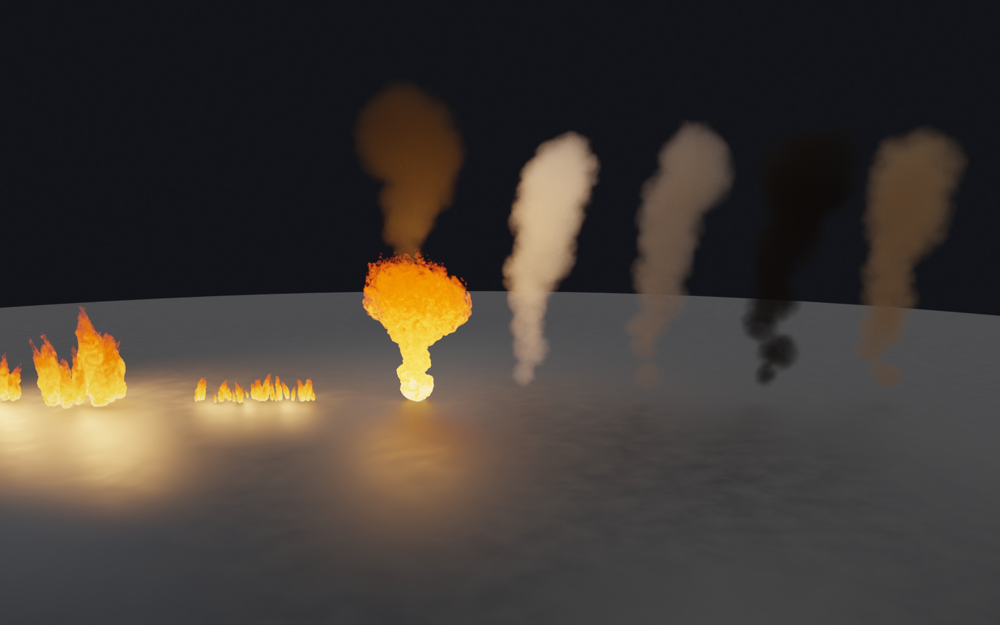

# 🔥 Kartu AR Karhutla

Aplikasi **Augmented Reality (AR) Android** tentang **kebakaran hutan dan lahan (karhutla)**. Pengguna memindai kartu fisik dengan kamera HP, lalu muncul model 3D animasi di atas kartu. Kalau beberapa kartu dipindai bersamaan, kartu-kartu itu **saling berinteraksi**: kartu pemicu menyulut kebakaran, kartu dampak terbakar, dan kartu mitigasi memadamkannya.

Dibuat dengan **Unity 6 + Vuforia Engine 11.4**. Semua model 3D dibuat di **Blender 5.2**.



---

## 📥 Download & Install (untuk pengguna)

### Syarat HP
- Android **10 atau lebih baru**, prosesor **64-bit** (hampir semua HP sejak 2019)
- Kamera belakang
- **Internet saat pertama kali membuka aplikasi** (untuk validasi lisensi Vuforia). Setelah itu aplikasi bisa dipakai offline.
- *Tidak perlu* Google Play Services for AR (ARCore). Mode Kartu jalan di HP biasa.

### Langkah instalasi
1. Buka halaman **[Releases](../../releases/latest)** di repo ini.
2. Di bagian **Assets**, unduh **`FireDisasterAR_Vuforia.apk`** (±198 MB).
3. Buka file APK di HP. Kalau muncul peringatan, izinkan **"Instal dari sumber tidak dikenal"** untuk browser atau file manager yang dipakai.
4. Kalau sebelumnya sudah memasang versi lama, **hapus dulu** versi lama itu, lalu instal yang baru.
5. Buka aplikasi **Fire Disaster AR**, lalu pilih **Izinkan** saat diminta akses kamera.

> Kalau APK tidak bisa dipasang, lihat [Troubleshooting](#-troubleshooting).

---

## 🃏 Cetak Kartu

File siap cetak ada di folder **[`kartu/`](kartu/)**:

| File | Isi |
|---|---|
| `Kartu_AR_Karhutla_A4.pdf` | 6 kartu dalam 1 lembar A4 lengkap dengan garis potong (**pakai ini untuk mencetak**) |
| `kartu_120_…png` – `kartu_125_…png` | Gambar per kartu (1494 × 2000 px) |

**Aturan cetak (penting untuk deteksi):**
- Cetak dengan skala **100% / Actual size**, matikan *Fit to page*. Ukuran kartu harus **63 × 84 mm**.
- Gunakan kertas **matte / art paper**, dan hindari laminasi glossy karena pantulan cahaya mengganggu kamera.
- Cetak berwarna, jangan sampai kartu terlipat atau tertekuk.

---

## 🎮 Cara Pakai

Saat dibuka, aplikasi langsung masuk ke **Mode Kartu**. Arahkan kamera ke kartu dari jarak **±20–40 cm** di tempat yang cukup terang.

### Daftar kartu

| No | Kategori | Kartu | Model AR yang muncul |
|---|---|---|---|
| 120 | 🔴 PEMICU | Pembakaran Lahan | Orang menyemburkan api (flamethrower) ke pohon |
| 121 | 🔴 PEMICU | Cuaca Ekstrem | Matahari terik, tanah retak, pohon meranggas |
| 122 | 🟤 DAMPAK | Kabut Asap | Beberapa rumah terbakar dan kabut asap tebal |
| 123 | 🟤 DAMPAK | Kerusakan Ekosistem | Hutan terbakar (pohon, semak, bara) |
| 124 | 🔵 MITIGASI | Water Bombing | Helikopter pemadam dengan *bambi bucket* |
| 125 | 🔵 MITIGASI | Tim Satgas Darat | Mobil pemadam dengan meriam air |

### Kombinasi kartu

Letakkan kartu berdampingan (jarak **10–20 cm**) dan pastikan semuanya terlihat di kamera.

| Kartu yang dipindai | Yang terjadi |
|---|---|
| 1 kartu | Model kartu itu muncul beserta penjelasannya |
| **Pemicu + Dampak** | Api dari kartu pemicu menjalar ke kartu dampak, lalu kartu dampak mulai terbakar |
| **Pemicu + Mitigasi** | Truk atau helikopter menyiram api dari kartu pemicu sampai padam (muncul uap air) |
| **Dampak + Mitigasi** | Kebakaran di kartu dampak dipadamkan |
| **Pemicu + Dampak + Mitigasi** | Sekuens lengkap: ① pemicu → ② api menjalar ke dampak → ③ mitigasi memadamkan semuanya |

Tombol di layar:
- **Ulangi Animasi**: memutar ulang sekuens kombinasi yang sedang terlihat.
- **Mode Taruh Bebas**: menaruh aset 3D bebas di lantai atau meja.

### Mode Taruh Bebas
1. Gerakkan HP perlahan ke arah lantai atau meja sampai muncul lingkaran oranye.
2. Pilih aset di bar bawah, lalu **ketuk lantai** untuk menaruhnya.
3. Gunakan **dua jari** untuk memperbesar dan memutar. Tombol **Skala** mengganti antara ukuran miniatur dan ukuran asli 1:1.

> Mode ini memakai pelacakan lantai (Vuforia Ground Plane), yang butuh ARCore atau sensor yang didukung Vuforia. Di HP yang tidak mendukung akan muncul pesan **"Mode ini tidak didukung di HP ini"**. Mode Kartu tetap bisa dipakai.

---

## 📁 Isi Repository

```
Kartu-AR-Karhutla/
├── kartu/                     # 6 kartu siap cetak (PNG + PDF A4)
├── aset-3d/
│   ├── blender/               # Fire_Disaster_Asset_Pack.blend (semua aset, material procedural)
│   ├── glb/                   # Model siap-AR (tekstur sudah di-bake), bisa dipakai di Unity/Godot/web
│   └── blender-scripts/       # Skrip Python pembuat aset (procedural)
├── unity/FireDisasterAR/      # Proyek Unity (Assets, Packages, ProjectSettings)
└── docs/
    ├── BUILD_DARI_SOURCE.md   # Cara membuka & build ulang proyek Unity
    └── images/                # Render & tangkapan layar
```

APK **tidak** disimpan di dalam repo (melebihi batas 100 MB GitHub). Unduh APK di **[Releases](../../releases/latest)**.

---

## 🧱 Aset 3D

| Mobil pemadam | Rumah kayu terbakar | Reruntuhan batu |
|---|---|---|
|  |  |  |
| **Helikopter water bombing** | **Karakter penyembur api** | **Cuaca ekstrem** |
|  |  |  |
| **Pohon terbakar** | **Semak, batu, kayu, bara** | **Efek api & asap** |
|  |  |  |

Penjelasan lengkap ada di [`aset-3d/README.md`](aset-3d/README.md).

---

## 🛠 Build dari Source (untuk developer)

Lihat **[docs/BUILD_DARI_SOURCE.md](docs/BUILD_DARI_SOURCE.md)**. Ringkasnya: Unity **6000.6.6f1** + Android Build Support, impor paket Vuforia 11.4.4, isi license key Vuforia milikmu sendiri, setujui Vuforia Developer Agreement, lalu build.

> 🔑 License key Vuforia **sengaja tidak disertakan** di repo publik ini. Buat key gratis (Basic) di [developer.vuforia.com](https://developer.vuforia.com).

---

## ❓ Troubleshooting

| Masalah | Solusi |
|---|---|
| APK tidak bisa dipasang | Pastikan Android 10+, izinkan instal dari sumber tidak dikenal, dan hapus versi lama dulu. |
| Layar hitam atau kamera tidak muncul | Buka Pengaturan → Aplikasi → Fire Disaster AR → Izin → aktifkan **Kamera**. |
| Muncul pesan soal lisensi atau internet | Nyalakan internet, lalu buka ulang aplikasi (validasi lisensi hanya perlu sekali). |
| Kartu tidak terdeteksi | Pastikan memakai kartu dari folder `kartu/` (bukan kartu lama ber-QR), ruangan cukup terang, kertas tidak mengkilap, dan jarak 20–40 cm. |
| Interaksi antar-kartu tidak berjalan | Semua kartu harus terlihat di layar sekaligus. Mundurkan HP sedikit dan letakkan kartu lebih berdekatan. |
| Mode Taruh Bebas menampilkan pesan "tidak didukung" | HP tidak mendukung pelacakan lantai. Gunakan Mode Kartu. |

---

## 📚 Teknologi
- **Unity 6000.6.6f1** (Built-in Render Pipeline, IL2CPP, ARM64)
- **Vuforia Engine 11.4.4** (Instant Image Targets dibuat langsung dari gambar kartu, plus Ground Plane)
- **glTFast** untuk impor model GLB
- **Blender 5.2** (Cycles) untuk pemodelan procedural dan bake tekstur

## ⚖️ Catatan Hak Cipta
- Model 3D, skrip, dan efek di repo ini adalah karya orisinal proyek ini.
- Ilustrasi pada kartu **No. 120** dan **No. 124** memuat karakter fiksi milik pemegang hak ciptanya masing-masing, dan dipakai hanya untuk keperluan edukasi atau tugas kuliah, bukan untuk dijual.
- Vuforia Engine adalah produk PTC Inc. dan **tidak** didistribusikan ulang di repo ini.
